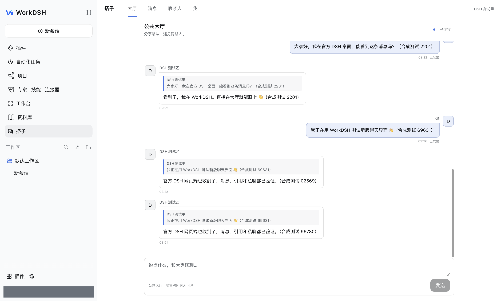

# DSH 搭子 · DSH Friends

**先聊起来，再认识彼此。**

安装在官方 [DeepSeek Harness](https://github.com/deepseek-ai/deepseek-harness) 上的独立插件：公共大厅、引用回复、私聊申请和加密文字聊天。WorkDSH 是兼容宿主，不是依赖。浏览大厅无需先加好友或创建发言身份；首次发言再设置昵称与本地身份。



## 当前进度

`0.1.0-alpha.4` 开发验收版，已经接入真实 Host / Client 和公共 Nostr 中继。不是只有离线设计稿，也还不是正式社交服务发行版。

| 验证对象 | 本次结果 |
|---|---|
| 官方 DeepSeek Harness Desktop `0.2.0-rc.2` | 原生安装/更新、入口、大厅收取与界面；初始开发包与 WorkDSH 跨桌面发送、回复已通过；最终包启动与身份保留已核对 |
| 已安装的 WorkDSH Desktop `3.0.0-alpha.3` / DSH `0.2.1-rc.2` | 原生安装、启用、新版气泡 UI，真实公网大厅与加密私聊通过 |
| 官方 DSH Web `0.2.1-rc.5` | 独立测试身份，与真实 WorkDSH 桌面互收大厅、引用回复、申请/接受/加密私聊通过 |
| 三个候选公共中继 | 实际收到公共写入确认，并验证私聊接收；不承诺每次发送所有节点都成功 |
| 深浅主题、窄面板、滚动 | 从原生 DSH 设置切换主题；气泡正文对比、输入区、历史滚动、新消息提示通过 |
| 尚未实测 | dataelement DSH Desktop `0.11.1`、Windows、macOS Intel、不同物理网络、其他 DSH 版本 |

所有网络验收均在本机的独立进程/身份间进行，使用合成测试内容。不能把同一电脑上的公网中继互通说成两台电脑、两种网络均已验收。具体证据与边界见 [原生接入记录](docs/NATIVE.md)。

## 使用方式

1. 在 DSH 的插件管理添加本插件 `.tgz`，安装后启用“dsh-friends”组件，从原生侧栏打开“搭子”。
2. 进入大厅并同意连接公共中继，可以先看聊天。未加入好友、未创建发言身份也能浏览。
3. 有话想说时，首次设置昵称与至少 12 字符的本地口令。身份在 Host 生成，完整名片不会因此自动加入发现列表。
4. 直接发言或引用回复。自己的消息靠右，别人的靠左；回复操作在消息旁，输入区常驻底部。
5. 想继续聊时点击昵称 → 发起私聊 → 对方接受。联系人关系在交流后建立，不作为大厅门槛。

**升级后请核对后台是否已更新。** 本次旧底座出现过界面已加载新包、Host 仍运行旧实例的情况。插件会提示版本不一致；重启应用后再解锁身份。身份和加密记录保留，不要为了更新而删除本地身份。

重复提交同一个、依赖没有变化的压缩包，旧安装器可能报“无法从依赖变更中确定安装了哪一个包”。已经安装的插件应从插件详情启用组件，不必反复安装。

## 连接与隐私

- 不需要自建项目账号服务器；依赖第三方 Nostr 公共中继的可达性与规则。当前候选：`relay.damus.io`、`relay.primal.net`、`nos.lol`。
- 大厅是公开文本。发言包含署名的公开标识和昵称，可能被长期保存。完整兴趣名片的发现功能另外自愿开启。
- 私聊使用 NIP-17 / NIP-44 / NIP-59；中继要求时，Host 按 NIP-42 签署仅限该连接的身份验证。私钥不离开 Host，也不写入浏览器存储或日志。
- 身份用 NIP-49 口令保护；联系人、私聊历史和持久待发队列也加密。本地身份备份不包含完整聊天历史。
- UI“已发出”表示至少一个中继接受，不代表对方收到或已读。失败保留内容，重试沿用原事件 ID。
- 只使用用户允许的候选节点，不自动拨打对方名片指定的未知地址。插件不会读取 AI 对话、工作区或模型配置，不执行别人发来的内容。
- 默认不公开完整名片，不扫描所有 DSH 安装。昵称不是官方认证，公钥也不证明对方安装了哪个客户端。

大厅首版缓存最近 30 天范围内最多 200 条有效消息；不是完整历史归档。当前不提供私密群组、多房间、附件/语音视频、已读回执、统一公共治理或完整多设备历史同步。

## 构建与安装

开发与本轮测试使用 Node.js 24；构建目标为 Node.js 22，插件声明最低 Node.js 22.14。接入目标明确列出 DSH `0.2.0-rc.2`、`0.2.1-rc.2` 和 `0.2.1-rc.5`，不宣称其他版本自动兼容。

```sh
git clone https://github.com/techflag/dsh-friends.git
cd dsh-friends
npm ci
npm run typecheck
npm test
npm run build
npm pack
```

生成 `dsh-friends-0.1.0-alpha.4.tgz`。Desktop 使用各自原生插件管理安装，不能把 Web profile 当成 Desktop 安装目录。Web 通过官方 CLI 安装：

```sh
dsh plugin --profile web add /完整路径/dsh-friends-0.1.0-alpha.4.tgz
dsh --profile web
```

本轮独立 SDK Web 测试配置需要正确提供宿主共享依赖；没有通过修改官方包来解决依赖锚点。Desktop 的安装、启用与版本加载均走各自原生入口。

## 验证与设计

- `npm test`：9 组服务测试，使用真正的回环 WebSocket 中继；含未建身份的大厅读取、引用、恢复、NIP-42、私聊和故障隔离。不会向公网发布。
- `npm run test:design`：预览启动后运行 13 项离线原型检查。原型人物是虚构的，不进入真实插件。
- `tests/desktop-network.mjs`：手动启动隔离实例后，验证实际 Host / Client 与公共中继。必须显式设置 `DSH_FRIENDS_ALLOW_PUBLIC_TEST=1`，只在获授权的网络验收中运行。
- `tests/desktop-ui.mjs`：真实原生渲染器的主题、气泡、草稿、滚动和窄窗口验证，也有公网写入开关。配置端口与测试环境见 NATIVE.md。

离线预览：

```sh
npm run preview
# http://127.0.0.1:18806/
```

预览默认零联系人；已有联系人演示场景为 `?scenario=returning#messages`。预览人物、在线状态、消息均虚构，CSP 禁止外部连接。真实插件不加载演示数据。

| 文档 | 内容 |
|---|---|
| [产品与交互](docs/PRODUCT.md) | 公共交流优先、私聊后置 |
| [UI 规范](docs/UI.md) | 聊天气泡、宿主主题、容器布局与可访问性 |
| [技术方案](docs/ARCHITECTURE.md) | 官方挂载、身份、存储与网络职责 |
| [通信协议](docs/PROTOCOL.md) | 公共消息、名片、加密私聊和中继身份验证 |
| [验收门槛](docs/ACCEPTANCE.md) | 已验范围及进一步发布检查 |
| [设计决策](docs/DECISIONS.md) | 取舍与实施调整 |
| [验证记录](docs/VERIFICATION.md) | 原型与真实接入结果 |

本项目是独立社区插件，与 DeepSeek 官方没有隶属或背书关系。
