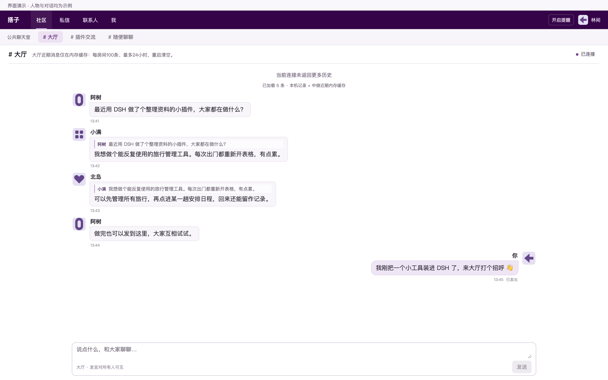

# DSH 搭子 · DSH Friends

**先聊起来，再认识彼此。**

安装在官方 [DeepSeek Harness](https://github.com/deepseek-ai/deepseek-harness) 上的独立插件：公共大厅、引用回复、私聊申请和加密文字聊天。WorkDSH 是兼容宿主，不是依赖。浏览大厅无需先加好友或创建发言身份；新 Mac 用户首次发言自动准备本机身份，无需注册或设置口令；昵称可在“我”中修改。



[下载通用插件包](https://github.com/techflag/dsh-friends/releases) · [社区中继与公开看板](https://relay.techflag.cn/)

在 DSH 原生插件管理中添加下载的 `.tgz`，启用后打开侧栏「搭子」。进入大厅先聊，聊得来再发起私聊。默认房间为大厅、插件交流和随便聊聊。

<details>
<summary>开发与兼容信息</summary>

## 当前进度

`0.1.0-alpha.10` 开发验收版，已经接入真实 Host / Client 和公共 Nostr 中继。不是只有离线设计稿，也还不是正式社交服务发行版。

| 验证对象 | 当前证据与边界 |
|---|---|
| 自建中继及公开看板 | HTTPS 已部署；合成身份通过公开聊天、引用、私聊、新用户近期历史及统计重启恢复验收 |
| 本地检查 | 类型/构建/聊天 UI 检查，以及服务、身份、房间与代理测试；Windows 原生 DPAPI 项在 Mac 明确跳过 |
| 早期 Mac 桌面包 | 官方 DSH Desktop、WorkDSH、官方 Web 的原生安装和互通已验证；这些是旧构建证据，不等于 alpha.10 桌面重跑 |
| 仍待验收 | Windows 完整流程、dataelement Desktop、macOS Intel、两台物理客户端/不同客户端网络 |

当前服务端测试使用同一 Mac 环境的独立身份连接真实公网服务器，不等于 Windows 与 Mac 双机均已验收。历史记录与具体范围见 [原生接入记录](docs/NATIVE.md)。

</details>

## 使用方式

1. 在 DSH 的插件管理添加本插件 `.tgz`，安装后启用“dsh-friends”组件，从原生侧栏打开“搭子”。
2. 进入大厅并同意连接公共中继，可以先看聊天。未加入好友、未创建发言身份也能浏览。
3. 在已验证的 macOS 上直接发言，首次发送自动生成本机身份并由系统钥匙串保管，重开自动恢复；无需填写口令。旧版锁定身份保留在“我 → 高级恢复”中，不会覆盖。同一个通用包已加入 Windows 适配，使用当前 Windows 用户范围的 DPAPI 安全保存；后台自动读取 Windows 静态系统代理，失败原因显示在节点下方。尚待 Windows 实机安装、发言和重启验收；Linux 尚无适配。
4. 顶部切换大厅、插件交流、随便聊聊。下方连续聊天，自己的消息靠右、别人的靠左，输入区固定底部；已有记录保存在本机；默认中继转发实时消息，并提供每房间最近100条、最多24小时的内存历史，重启清空。
5. 想继续聊时点击昵称 → 发起私聊 → 对方接受。联系人关系在交流后建立，不作为大厅门槛。

**升级后请核对后台是否已更新。** 本次旧底座出现过界面已加载新包、Host 仍运行旧实例的情况。插件会提示版本不一致；重启应用后，本机自动身份会恢复；旧版身份仍使用原恢复方式。身份和加密记录保留，不要为了更新而删除本地身份。

重复提交同一个、依赖没有变化的压缩包，旧安装器可能报“无法从依赖变更中确定安装了哪一个包”。已经安装的插件应从插件详情启用组件，不必反复安装。

## 连接与隐私

- 不需要用户注册项目账号。当前默认只连接自建中继 `relay.techflag.cn`，不会自动把聊天发往旧的第三方候选节点。
- 大厅是公开文本。发言包含署名的公开标识和昵称，可能被长期保存。完整兴趣名片的发现功能另外自愿开启。
- 私聊使用 NIP-17 / NIP-44 / NIP-59；中继要求时，Host 按 NIP-42 签署仅限该连接的身份验证。私钥不离开 Host，也不写入浏览器存储或日志。
- 身份继续用 NIP-49 加密；Mac 自动模式的随机解锁凭据由系统钥匙串保管，不进入浏览器、日志或命令参数。联系人、私聊历史和待发队列也加密。新自动模式暂不提供跨设备身份导出。
- UI“已发出”表示至少一个中继接受，不代表对方收到或已读。失败保留内容，重试沿用原事件 ID。
- 只使用用户允许的候选节点，不自动拨打对方名片指定的未知地址。插件不会读取 AI 对话、工作区或模型配置，不执行别人发来的内容。
- 默认不公开完整名片，不扫描所有 DSH 安装。昵称不是官方认证，公钥也不证明对方安装了哪个客户端。

三个默认房间各在客户端缓存最近 300 条已收到的公共消息。当前默认中继仅在内存保留每房间最近100条、最多24小时，重启清空；私聊不缓存，均不是完整归档。当前不提供创建房间、私密群、附件/语音视频、已读回执或完整多设备同步。

系统提醒默认关闭，可手动开启。已验证 WorkDSH 最小化、插件页不在前台时的真实通知，以及官方 macOS Desktop 关闭窗口后的通知。当前 WorkDSH 关闭窗口会销毁页面，通知随之停止；彻底退出后均停止即时接收。重开可恢复本机已有记录，并补看仍在中继内存缓存范围内的公开消息；私聊不补发。

早期双桌面、系统通知和 Mac 首次免口令发言的记录，及本轮自建节点的最新证据，均见 [NATIVE.md](docs/NATIVE.md)；每项验收只适用于注明的构建和平台。

## 自建中继与公开运营看板

当前通用包默认只连接 `wss://relay.techflag.cn`。公开看板：https://relay.techflag.cn/ ，无需登录，展示累计用户、每日活跃、在线连接、公开聊天室消息计数和七日趋势。

**特别声明：中继不将聊天正文写入磁盘或日志。每房间最近100条公开消息仅在内存缓存最多24小时，重启清空；私聊信封仅转发，不缓存或离线补发。** 只持久保存运营统计及用于计数的脱敏身份/事件去重标识。公开名片和收件路由在内存短暂保留，不写入运营统计文件。客户端仍可保存已收到的本机记录，公开消息每房间最近 300 条。

用户数依据签名验证的身份去重，不是实名人数；不同电脑创建的独立身份可能分别计数。在线连接数也不是在线人数。已通过同一客户端环境与真实自建服务器的公开聊天、引用、私聊、新用户近期历史及统计重启恢复验收；Windows 和两台物理设备的回测仍待完成。

后文或旧验收记录中“从公共中继补载历史”描述的是旧版第三方中继行为，不适用于当前默认的实时中继。服务端源码、无内容存储检查和部署说明见 `deploy/relay`。

## 构建与安装

开发与本轮测试使用 Node.js 24；构建目标为 Node.js 22，插件声明最低 Node.js 22.14。接入目标明确列出 DSH `0.2.0-rc.2`、`0.2.1-rc.2` 和 `0.2.1-rc.5`，不宣称其他版本自动兼容。

```sh
git clone https://github.com/techflag/dsh-friends.git
cd dsh-friends
npm ci
npm run typecheck
npm test
npm run build
npm pack
```

只生成一个通用包 `dsh-friends-0.1.0-alpha.10.tgz`，Mac 和 Windows 使用同一文件，不分别发行系统版本。安装步骤和平台实测状态见 [安装说明](INSTALL.md)。Desktop 使用各自原生插件管理安装，不能把 Web profile 当成 Desktop 安装目录。Web 通过官方 CLI 安装：

```sh
dsh plugin --profile web add /完整路径/dsh-friends-0.1.0-alpha.10.tgz
dsh --profile web
```

本轮独立 SDK Web 测试配置需要正确提供宿主共享依赖；没有通过修改官方包来解决依赖锚点。Desktop 的安装、启用与版本加载均走各自原生入口。

## 验证与设计

- `npm test`：9 组服务测试，使用真正的回环 WebSocket 中继；含未建身份的大厅读取、引用、恢复、NIP-42、私聊和故障隔离。不会向公网发布。
- `npm run test:design`：预览启动后运行 13 项离线原型检查。原型人物是虚构的，不进入真实插件。
- `tests/desktop-network.mjs`：手动启动隔离实例后，验证实际 Host / Client 与公共中继。必须显式设置 `DSH_FRIENDS_ALLOW_PUBLIC_TEST=1`，只在获授权的网络验收中运行。
- `tests/desktop-ui.mjs`：真实原生渲染器的主题、气泡、草稿、滚动和窄窗口验证，也有公网写入开关。配置端口与测试环境见 NATIVE.md。

离线预览：

```sh
npm run preview
# http://127.0.0.1:18806/
```

预览默认零联系人；已有联系人演示场景为 `?scenario=returning#messages`。预览人物、在线状态、消息均虚构，CSP 禁止外部连接。真实插件不加载演示数据。

| 文档 | 内容 |
|---|---|
| [产品与交互](docs/PRODUCT.md) | 公共交流优先、私聊后置 |
| [UI 规范](docs/UI.md) | 聊天气泡、宿主主题、容器布局与可访问性 |
| [技术方案](docs/ARCHITECTURE.md) | 官方挂载、身份、存储与网络职责 |
| [通信协议](docs/PROTOCOL.md) | 公共消息、名片、加密私聊和中继身份验证 |
| [验收门槛](docs/ACCEPTANCE.md) | 已验范围及进一步发布检查 |
| [设计决策](docs/DECISIONS.md) | 取舍与实施调整 |
| [验证记录](docs/VERIFICATION.md) | 原型与真实接入结果 |

本项目是独立社区插件，与 DeepSeek 官方没有隶属或背书关系。
