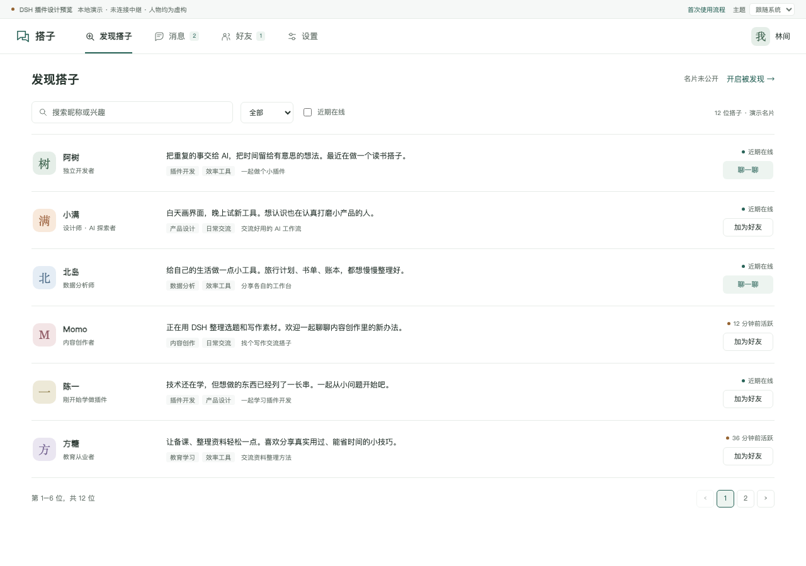
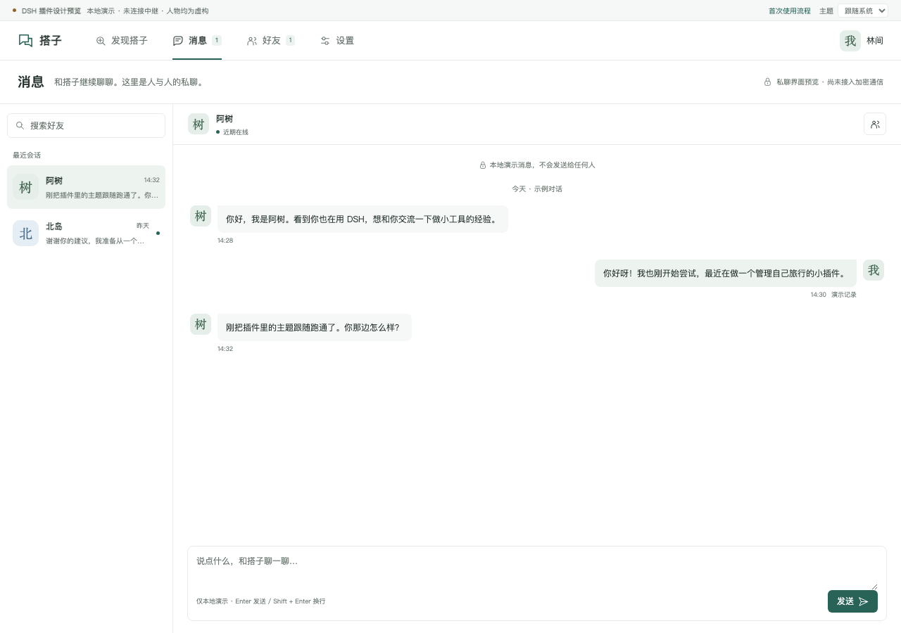
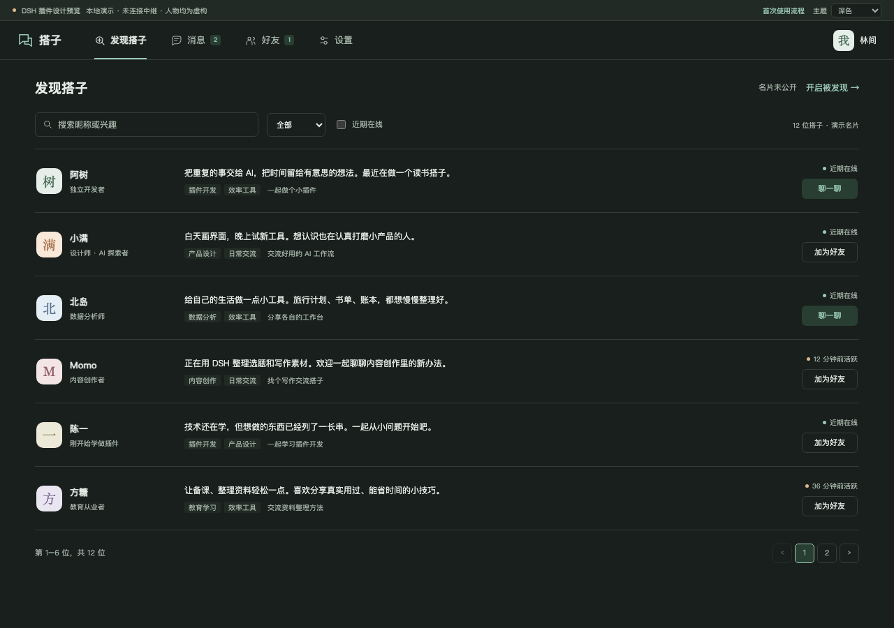

# DSH 搭子 · DSH Friends

**在 DSH 里，遇见同路人。**

安装一个插件，认识也在使用 DSH 的人：交流工具心得、分享想法，或一起做点有意思的事。

这是面向 **官方 DeepSeek Harness（DSH）** 的独立插件项目。WorkDSH 可作为兼容宿主，不是前置条件；无需 WorkDSH 企业账号。

> 当前阶段：产品设计、技术方案和离线交互原型。**尚未提供可安装插件包，也没有完成真实中继通信。** 下图中人物、消息、在线状态全部为虚构演示。



## 先体验设计

需要 Node.js 20 或更新版本，预览不需要安装依赖：

```sh
git clone https://github.com/techflag/dsh-friends.git
cd dsh-friends
npm run preview
```

打开终端显示的本地地址（默认 `http://127.0.0.1:18806`）。端口被占用时可设置 `PORT`。

可以体验：

- 搜索搭子、按兴趣/近期在线筛选、翻页、查看名片。
- 填写自己的名片，确认后开启/关闭被发现。
- 发送演示邀请、接受/忽略邀请、好友文字聊天。
- 在设置里模拟断网，体验消息失败、保留内容和重试。
- 屏蔽与解除屏蔽、浅色/深色/跟随系统、小窗口布局。

原型仅使用浏览器内存，不生成密钥，不读取 DSH，不连接中继，不发送真实消息。刷新重置。预览服务器的内容安全策略禁止网络连接。

## 在 DSH 中的形态

```text
官方 DSH
├─ 原有对话、项目、插件等：由宿主保留
└─ 搭子                     ← 本插件注册一个原生侧栏入口
   ├─ 发现搭子               ← 插件主面板内导航
   ├─ 消息                   ← 人与人的私聊，不是 AI 对话
   ├─ 好友
   └─ 设置
```

正式实现通过官方 Host/Client 插件机制、公开侧栏和主面板插槽接入。**不修改官方源码或插件包，不复制 AI 会话界面，不做独立 Electron 客户端。** 当前预览里左边的四项导航属于插件内部，不是另造 DSH 全局侧栏。

## 设计文档

| 文档 | 内容 |
|---|---|
| [产品与交互](docs/PRODUCT.md) | 首版范围、首次使用、好友/聊天状态、异常与隐私 |
| [UI 规范](docs/UI.md) | 页面布局、宿主主题、滚动/分页、窄窗口、可访问性 |
| [技术方案](docs/ARCHITECTURE.md) | 官方 DSH 接入、Host/Client 职责、存储、依赖与风险 |
| [通信草案](docs/PROTOCOL.md) | Nostr 发现、活动租约、好友握手、私聊与回执边界 |
| [开发与验收计划](docs/ACCEPTANCE.md) | 下一阶段顺序、两端实测、恢复/失败场景、发布门槛 |
| [设计决策](docs/DECISIONS.md) | 关键选择、备选方案与取舍 |

## 界面预览

消息使用独立聊天布局，发送区固定可见；AI 原生对话由 DSH 自己管理。





## 下一阶段

先在纯官方 DSH 上验证一个原生入口与空面板，再验证安全身份存储和公共中继的真实读写。两端互发现、邀请、加密私聊和中断恢复跑通后，才提供 `.tgz` 安装包。具体门槛见验收计划。

公共中继是别人运营的服务，不保证长期免费、可达或保存数据。首版不要求项目作者自建服务器；能否采用候选节点，要以真实协议测试结果为准。

## 设计回归

开发检查需要安装 Playwright（仅用于验证原型）：

```sh
npm ci
npx playwright install chromium
npm run preview
# 在另一个终端运行
npm run test:design
```

检查覆盖邀请、筛选分页、显式发布确认、消息失败/重试、屏蔽、窄屏和系统主题。不代表真实 DSH 或 Nostr 集成通过。

本项目是社区插件，与 DeepSeek 官方没有隶属或背书关系。
