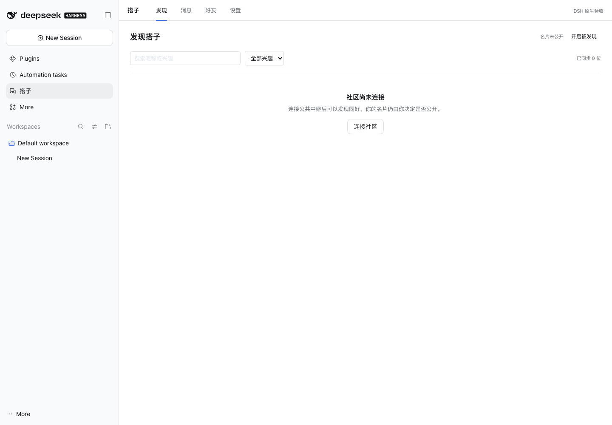

# DSH 搭子 · DSH Friends

**在 DSH 里，遇见同路人。**

面向官方 [DeepSeek Harness](https://github.com/deepseek-ai/deepseek-harness) 的独立插件：发现同好、发送好友邀请、加密文字私聊。WorkDSH 可以作为兼容宿主，不是前置条件；不需要 WorkDSH 企业账号，也不需要调用 AI 模型。

## 当前进度

`0.1.0-alpha.1` 开发版。已从离线设计进入真实 Host / Client 实现。

| 能力 | 实现与验证 |
|---|---|
| 官方 DSH 原生侧栏入口、主面板 | 已在纯官方 DSH `0.2.1-rc.5` Web 中安装并操作 |
| 紧凑列表、分页、窄窗口、宿主主题 | 使用官方组件和 `--dsw-*` 主题变量；无独立客户端外壳 |
| 本地身份、加密备份、导入、锁定/解锁 | 使用 Nostr NIP-49；仅 Host 持有解锁后的私钥 |
| 公开名片、近期活动、停止发布 | 已通过独立身份与真实本地 WebSocket 中继验证 |
| 好友邀请、接受、忽略、屏蔽 | 已实现并在两端服务测试中验证 |
| 加密文字私聊、待发队列、重试、重启恢复 | 已通过两端真实通信验证；磁盘聊天记录也加密 |
| 公共中继 | 三个候选节点经 DSH 代理握手成功；尚未验收公网双端发现和收信 |
| Desktop / Windows / 其他 DSH 版本 | 尚未实际验收，不宣称已兼容 |

当前还不适合作为正式社交服务发布。没有自建账号服务器，不代表没有网络依赖；公共中继的可达性、接收规则与数据保留仍需验证。



上图来自真实官方 DSH 测试配置，使用合成身份。初次打开不显示虚构用户，也不会自动发布名片。

## 构建与安装

开发环境需要 Node.js 24。当前插件仅以 DSH `0.2.1-rc.5` 为接入与兼容目标。

```sh
git clone https://github.com/techflag/dsh-friends.git
cd dsh-friends
npm ci
npm run typecheck
npm test
npm run build
npm pack
```

生成 `dsh-friends-0.1.0-alpha.1.tgz`。在官方 Web profile 安装：

```sh
dsh plugin --profile web add /完整路径/dsh-friends-0.1.0-alpha.1.tgz
dsh --profile web
```

使用你需要的 profile 名称替换 `web`；不要将 Web profile 当成 Desktop 安装目录。Desktop 应使用其插件管理入口和自身安装位置，待完成真实验收后补充对应记录。

在 DSH 侧栏打开“搭子”后：

1. 创建本地身份，设置至少 12 字符的口令，下载加密身份备份；或导入本插件生成的备份。
2. 明确同意后连接社区。连接本身不发布名片；中继可以看到网络地址和收信所用公开身份标识。
3. 选择“开启被发现”，核对公开字段后再加入。名片未收到中继确认时不会显示“已发布”。
4. 找到搭子，发送邀请；双方确认后进行文字私聊。

“已到中继”表示中继接受了加密消息，不表示对方已读。遇到网络故障，已提交的待发消息保留在本机，可重试；尚未提交的内容保留在输入框中。

插件沿用 DSH 官方的进程代理策略，不另造代理设置。本次网络中，直连三个候选节点失败，经 DSH 代理连接成功；不能据此承诺其他网络均可用。

## 数据与边界

- 通过官方插件 bundle、Host / Client、侧栏及主面板接口接入。**不修改官方源码或插件包，不复制 AI 对话界面。**
- 身份使用 NIP-49 口令加密；当前支持 log_n 为 16–18 的加密备份。创建身份使用 16；不接收明文私钥导入。
- 私钥只在 Host 解锁期间使用；身份备份不包含完整聊天历史，口令和备份需要自行保管。
- 私聊采用 NIP-17 / NIP-59 / NIP-44，由 `nostr-tools` 实现，不自行编写密码算法。
- 聊天、关系和待发队列以密文写入官方插件存储；读取失败不会自动清空数据库。
- 默认不公开。关闭发现后停止续租，互联网副本不能保证删除。加密也不代表隐藏 IP 或提供前向保密。
- 不读取 DSH 对话、工作区、文件或模型配置；收到的文本不会触发 Agent 或工具。

首版不做群聊、附件、语音视频、已读回执、邀请撤回或完整多设备聊天同步。发现范围限于共同中继上的兼容名片，不能发现所有 DSH 用户或证明对方实际安装了 DSH。

## 验证与设计

```sh
npm run typecheck
npm test
npm run build
```

原生 UI 的安装、操作和验证记录见 [原生接入记录](docs/NATIVE.md)。本地通信测试只使用回环中继，不向公共网络发布测试名片或消息。

保留可点击的离线设计稿：

```sh
npm run preview
# 打开 http://127.0.0.1:18806/
```

设计稿的人物、在线状态与消息均为虚构；真实插件不会加载这些演示数据。设计回归需要 `npx playwright install chromium` 后，在预览运行时执行 `npm run test:design`。

| 文档 | 内容 |
|---|---|
| [产品与交互](docs/PRODUCT.md) | 需求、状态与首版范围 |
| [UI 规范](docs/UI.md) | 紧凑布局、宿主主题、容器尺寸与可访问性 |
| [技术方案](docs/ARCHITECTURE.md) | 官方接入、身份、存储与网络职责 |
| [通信草案](docs/PROTOCOL.md) | 名片、好友与私聊协议 |
| [验收计划](docs/ACCEPTANCE.md) | 公网、Desktop、恢复与正式发布门槛 |
| [设计决策](docs/DECISIONS.md) | 方案取舍与实施调整 |
| [验证记录](docs/VERIFICATION.md) | 离线原型与本轮真实接入证据 |

本项目是独立社区插件，与 DeepSeek 官方没有隶属或背书关系。
