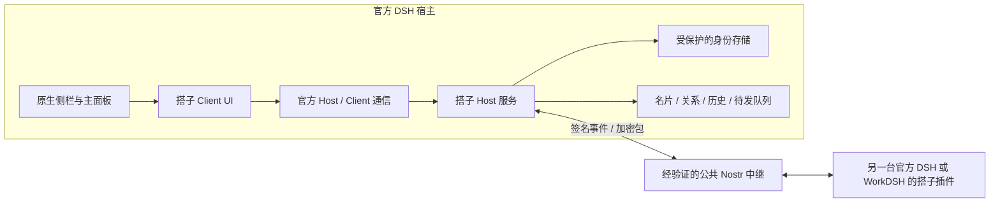

# 技术设计 · 官方 DSH 独立插件

状态：提案。目标起点 DSH `0.2.1-rc.5`；DSH 和 WorkDSH 都需实测，不承诺所有衍生发行版兼容。

## 总体结构

不增加项目专用账号后台。中继依然是别人运营的服务器，数据保留、费用、认证、可达性由其规则决定。预览不连接这些节点。

## 官方扩展边界与核对记录

已只读查看官方 rc.5 npm 发布包的声明/样式，以及本机 rc.5 升级工作树中的 WorkDSH 插件适配代码：

- `packages/plugins/workbenches/src/client.tsx` 使用 `ctx.slots.register` 的 `main`、`sidebar.panellist`，通过 `ctx.layout.selectPanel` 选择面板；注销时释放入口。
- 正式实现只采用这类公开注册方式，不依赖 WorkDSH 的工作台服务或外层布局补丁。
- 官方 `dsh-client-ui-sidebar/lib/types/client/contract/slots.d.ts` 声明 `sidebar.panellist`；`dsh-client-ui-layout/lib/types/client/service.d.ts` 声明 `selectPanel`。官方 primitives 使用继承的 `--dsw-*` 变量；`dsh-client-ui-theme/client` 提供主题快照与 `theme/change`，详见 UI 规范。
- `dsh.bundle.patch` 与 `dsh.client` 是待采用的插件包声明机制。最终 manifest 从目标官方版本真实类型/开发资源核对，不在设计期造一个“看似可安装”的 manifest。
- 参考现有适配代码证明有公开接入路径；不等于本仓库已经在纯 DSH 通过验证。

权威入口：[官方 DSH rc.5 源码与 CLI 文档](https://github.com/deepseek-ai/deepseek-harness/tree/dsh-v0.2.1-rc.5)。实现前应锁定已发布依赖的精确版本、导出和类型签名。

## Host 与 Client 分工

| Host 持有 | Client 持有 |
|---|---|
| 私钥、签名、加解密、安全备份 | 可公开资料、脱敏身份摘要、界面状态 |
| 中继连接、订阅、退避、配额 | 筛选、分页、表单、草稿视图 |
| 协议验证、活动过期、去重 | 展示真实阶段和失败动作 |
| 消息历史、关系、持久化待发队列 | 调用明确的 Host 命令 |

Client 不直接连接中继，不接收私钥或无范围的签名能力。Host 不执行消息里的命令，也不自动把消息交给 Agent。正式服务名称、rpc/event 导出以官方可用机制确定，下面只是业务契约草案：

- Identity：create/import/backup/status；导出备份走受控文件流程，私钥不经过常规 UI 状态。
- Profile：get/update/publish/stopDiscovery。
- Discovery：snapshot/filter/page；返回同步范围、游标、节点健康和截止时间。
- Friends：requests/accept/ignore/cancel/block/unblock。
- Messages：threads/history/send/retry；返回持久消息 ID 与状态修订。
- Relays：inspect/connect/disconnect；候选配置单独校验，不提供任意网络代理。

每条可变命令带请求 ID 和版本，校验参数大小。Client 重载后从 Host 重新同步，不用“接口没报错”替代业务回执。

## 身份与存储

1. 独立身份密钥，不复用模型 Key、企业 token 或 DSH 登录凭据。
2. 必须先验证官方 Host 安全存储能否保存本插件任意密钥，并在 Web/Desktop 下满足隔离与恢复要求。不能仅凭存在 `dsh-credentials` 包就假设适用。
3. 若没有满足条件的安全存储：阻止自动持久保存私钥。评估官方允许的系统密钥链或口令加密方案，形成独立决策；不降级到 localStorage/plain JSON。
4. 聊天/名片等数据使用宿主提供的插件隔离本地存储；先验证原子写、锁、迁移。首版不自行引入原生 SQLite 模块，减少跨平台 ABI 风险。
5. 数据分版本：身份描述、资料、关系、屏蔽、线程、消息、待发和去重索引分开。升级先迁移可恢复副本，读取失败不能覆盖为空。
6. 身份备份与聊天备份分开。换设备导入身份并不保证中继保存着全部消息。

## 可靠性

- 每个节点一条连接，多订阅复用。连接、认证、查询、发布回执与订阅分别有超时。
- 有界队列、事件长度上限、订阅上限、去重窗口、单会话消息分页；不无限抓全网历史。
- 指数退避和随机抖动，失败节点隔离。默认不持久刷高频心跳。
- 先持久保存发送意图，再发送，再按真实 ACK 更新。断电/重启恢复同一条消息，不能因重试新建重复条目。
- 带过期/撤销/修订的事件处理次序见通信草案；不能只靠到达顺序。
- 日志只记录事件 ID、节点、错误类别等必要信息；不输出私钥、明文消息和完整用户标识聚合。
- 卸载插件清理连接和定时器，保留用户数据，除非用户明确删除。

## 依赖与部署

正式包拟用 TypeScript、官方 Client React/主题 primitives、经维护的 Nostr 库。Nostr 库版本、浏览器/Node 能力、NIP 测试向量和许可证须验证后锁定；本阶段不安装生产通信依赖。密码学不自行实现。

当前仓库的 package.json 只供离线预览，`private: true`，不冒充正式插件。正式阶段新增 Host/Client 源码、bundle patch、类型声明、构建和纯 DSH 安装测试后再提供可安装产物。

## 开放风险与验证门槛

| 风险 | 必须验证 |
|---|---|
| 公共中继拒绝自定义事件或控制频率 | 两端签名发布、确认、订阅和恢复，不只 HTTP 页面可访问 |
| 发现可用但加密收件不支持 | 单独验证 kind 1059、10050 与必要认证 |
| 用户网络到节点不可达 | 至少两种网络，记录每节点结果；代理与直连分开记录 |
| 密钥安全与 Web/Desktop 差异 | 官方隔离存储、解锁、备份恢复与日志审计 |
| 公开活动被收集 | 显式加入、稀疏心跳、粗粒度展示、停止续租与明确告知 |
| 伪装昵称、骚扰 | 完整公钥核对、加密请求箱、大小/速率限制、本地屏蔽 |

任何一项未通过，在 UI 中保留未准备状态，不发布“已经可用”的版本。
